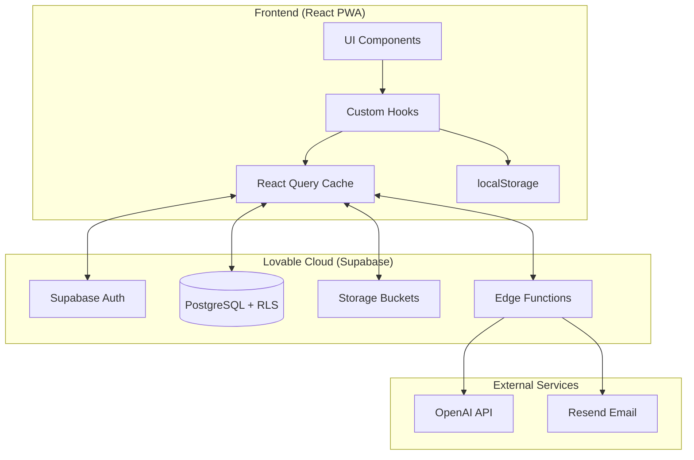
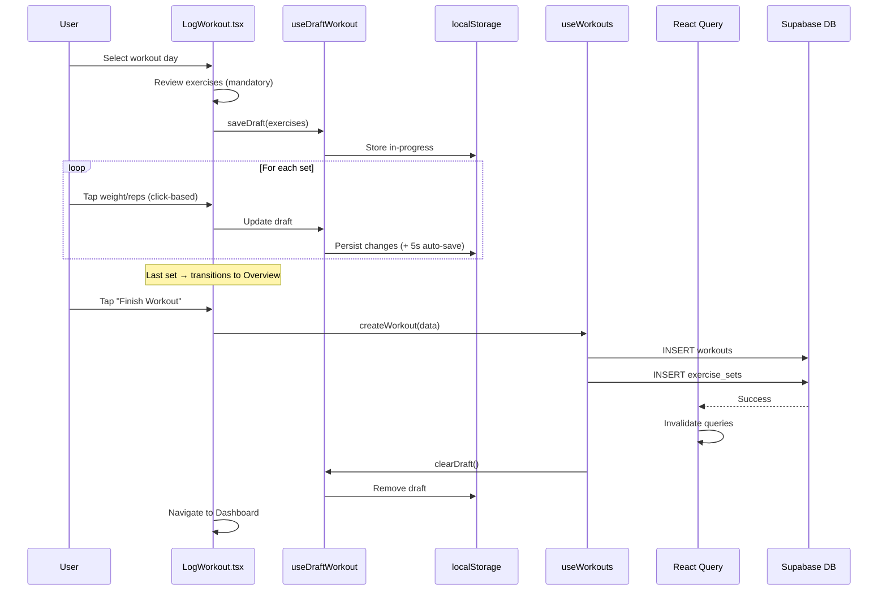
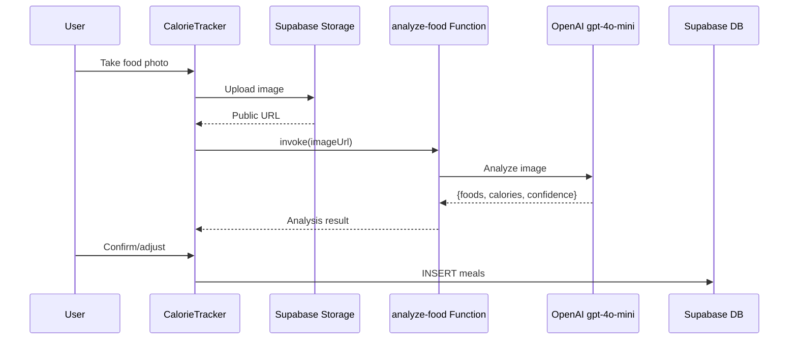
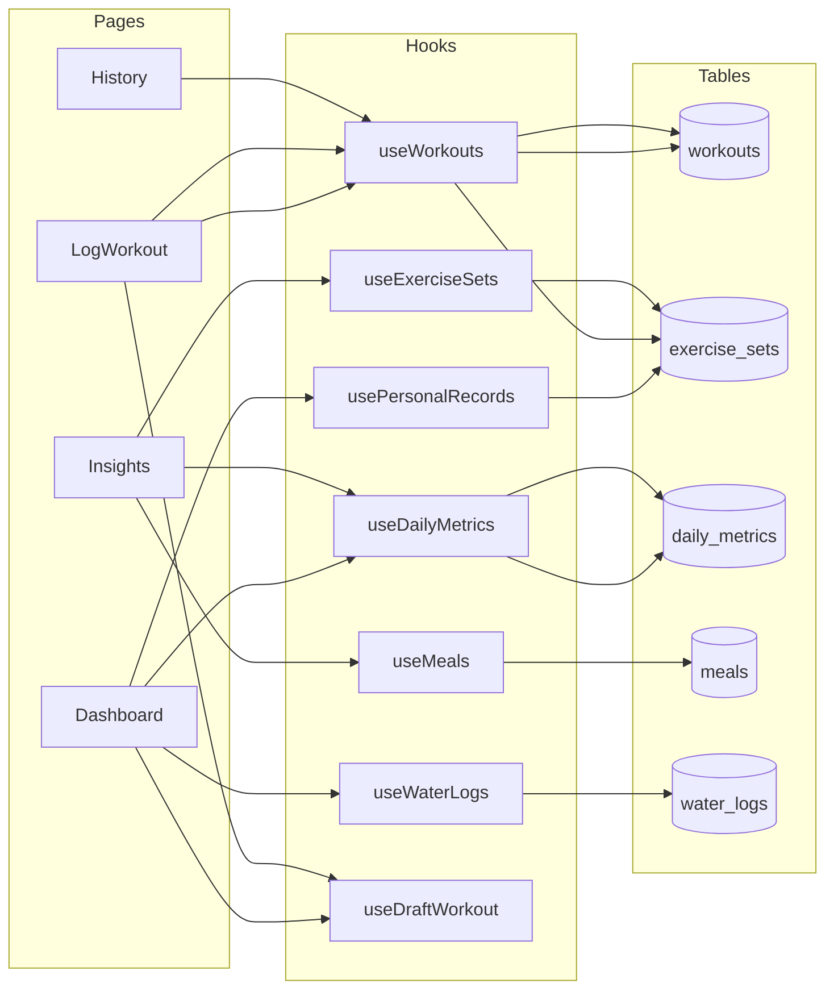
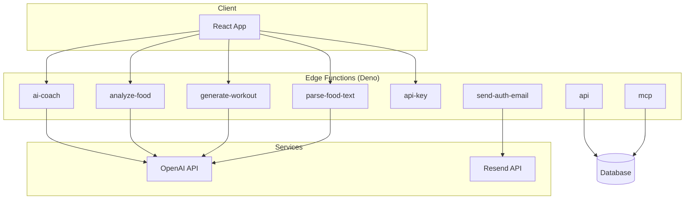

# HEALTH/OS – Personal Health Operating System

> **Version:** 2.0.0 | **Platform:** Progressive Web App (PWA) + Capacitor Native  
> **Production:** https://reps-and-reminders.lovable.app  
> **Last Updated:** February 2026

---

## Table of Contents

1. [Project Overview](#project-overview)
2. [Technology Stack](#technology-stack)
3. [Architecture](#architecture)
4. [Database Schema](#database-schema)
5. [Authentication Flow](#authentication-flow)
6. [User Flows](#user-flows)
7. [Core Hooks](#core-hooks)
8. [Components](#components)
9. [Edge Functions](#edge-functions)
10. [Design System](#design-system)
11. [API Reference](#api-reference)
12. [Development](#development)
13. [Deployment](#deployment)

---

## Project Overview

**HEALTH/OS** is a comprehensive personal health operating system that centralizes fitness tracking, nutrition logging, vitals monitoring, and workout planning into a single mobile-first PWA.

### Core Features
- **Workout Logging** – Set-by-set exercise tracking with progressive overload, draft persistence, and explicit finish flow
- **Adaptive Next Workout** – The Today screen picks your next split day and suggests evidence-based progression (double progression) from your own history
- **Flexible Routines** – Split-based programs (Full Body, Upper/Lower, PPL5, PPL6) with AI generation
- **Nutrition Tracking** – AI-powered food analysis from photos + text + manual calorie logging
- **Hydration** – Water intake tracking with visual progress
- **Daily Check-ins** – Morning/night vitals (sleep, energy, weight, steps)
- **Analytics** – Strength progression, body composition, ML insights, correlation analysis
- **Personal Records** – Automatic PR detection across all exercises
- **AI Coach** – Context-aware coaching insights (Lovable AI Gateway)
- **Blog/SEO** – Built-in blog with 40+ fitness articles for organic traffic
- **Account control** – Full data export/import (CSV) and one-tap account deletion (GDPR)

> Note: the previously documented public REST API and MCP server edge functions
> have been removed; the app no longer exposes API-key access.

---

## Technology Stack

### Frontend
| Technology | Version | Purpose |
|------------|---------|---------|
| **React** | ^18.3.1 | UI library |
| **TypeScript** | ^5.x | Type safety |
| **Vite** | ^5.x | Build tool & dev server |
| **Material UI (MUI)** | ^7.3.7 | UI component framework |
| **Tailwind CSS** | ^3.x | Utility CSS |
| **Framer Motion** | ^12.29.2 | Animations |
| **React Router** | ^6.30.1 | Client-side routing |
| **TanStack React Query** | ^5.83.0 | Server state management |
| **Recharts** | ^2.15.4 | Data visualization |

### Backend (Lovable Cloud / Supabase)
| Technology | Purpose |
|------------|---------|
| **Supabase Auth** | Email/password authentication |
| **Supabase Database** | PostgreSQL with RLS policies |
| **Supabase Storage** | Meal photo uploads |
| **Edge Functions (Deno)** | AI integration, API, MCP |

### AI Models
| Model | Used By |
|-------|---------|
| **OpenAI gpt-4o** | analyze-food (vision — most accurate for food photos) |
| **OpenAI gpt-4o-mini** | generate-workout, parse-food-text |
| **Lovable AI Gateway (gemini-2.5-flash)** | ai-coach insights |

All AI edge functions are JWT-protected and per-user rate limited server-side
via the `check_rate_limit` RPC (ai-coach 10/min, analyze-food 15/min,
generate-workout 5/min, parse-food-text 20/min).

### Native (Capacitor)
| Package | Version | Purpose |
|---------|---------|---------|
| **@capacitor/core** | ^8.0.1 | Native bridge |
| **@capacitor/ios** | ^8.0.1 | iOS platform |
| **@capacitor/android** | ^8.0.1 | Android platform |

### Key Dependencies
```json
{
  "@emotion/react": "^11.14.0",
  "@emotion/styled": "^11.14.1",
  "@supabase/supabase-js": "^2.90.0",
  "date-fns": "^3.6.0",
  "lucide-react": "^0.462.0",
  "sonner": "^1.7.4",
  "zod": "^3.25.76",
  "react-hook-form": "^7.61.1",
  "vaul": "^0.9.9"
}
```

---

## Architecture

### Directory Structure
```
src/
├── App.tsx                    # Root component with providers
├── main.tsx                   # Entry point
├── index.css                  # Global styles & CSS variables
│
├── pages/                     # Route components
│   ├── AppIndex.tsx           # Auth gate → onboarding → dashboard
│   ├── Landing.tsx            # Public landing page
│   ├── Auth.tsx               # Auth wrapper
│   ├── SignIn.tsx              # Sign-in page
│   ├── SignUp.tsx              # Sign-up page
│   ├── Dashboard.tsx          # Main dashboard view
│   ├── LogWorkout.tsx         # Workout logging wizard
│   ├── Insights.tsx           # Analytics & charts
│   ├── History.tsx            # Workout history list
│   ├── WorkoutDetail.tsx      # Single workout view
│   ├── Settings.tsx           # User preferences
│   ├── Blog.tsx               # Blog listing page
│   ├── BlogPost.tsx           # Individual blog post
│   ├── Privacy.tsx            # Privacy policy
│   └── NotFound.tsx           # 404 page
│
├── components/
│   ├── auth/                  # Auth forms
│   ├── dashboard/             # Dashboard widgets
│   ├── health/                # Calorie tracking, nutrition insights
│   ├── analytics/             # Charts & insights
│   ├── workout/               # Exercise logging components
│   ├── onboarding/            # Onboarding flow
│   ├── landing/               # Landing page sections
│   ├── layout/                # Header, BottomNav, MainLayout
│   ├── settings/              # Settings sections
│   ├── pwa/                   # PWA install prompt
│   └── ui/                    # shadcn/ui primitives
│
├── hooks/                     # Custom React hooks (26 files)
├── contexts/                  # React contexts (Theme, DateRange)
├── data/                      # Blog post data
├── integrations/supabase/     # Auto-generated Supabase types
├── lib/                       # Utilities (exercise library, haptics, etc.)
└── theme/                     # MUI theme configuration

supabase/
├── config.toml                # Supabase configuration
└── functions/                 # Edge functions (Deno)
    ├── ai-coach/              # AI workout coaching
    ├── analyze-food/          # AI food image analysis
    ├── generate-workout/      # AI workout generation
    ├── parse-food-text/       # Natural language food parsing
    ├── api-key/               # User API key management
    ├── api/                   # Public REST API
    ├── mcp/                   # Model Context Protocol server
    └── send-auth-email/       # Custom auth emails via Resend
```

### High-Level System Architecture



### Data Flow: Workout Logging



### Data Flow: AI Food Analysis



### Component-Hook-Database Relationships



### Authentication & Authorization Flow

```mermaid
flowchart TD
    Start([App Launch]) --> Check{Session exists?}
    Check -->|No| Landing[Landing Page]
    Landing --> Auth[Sign In / Sign Up]
    Check -->|Yes| Prefs{Preferences exist?}
    
    Auth -->|Sign Up| Create[Create Account]
    Auth -->|Sign In| Login[Authenticate]
    Create --> Prefs
    Login --> Prefs

    Prefs -->|No/Not Complete| Onboard[OnboardingFlow]
    Prefs -->|Yes| Dashboard[Dashboard]
    Onboard --> SavePrefs[Save Preferences]
    SavePrefs --> Dashboard

    subgraph RLS["Row Level Security"]
        Dashboard -->|All Queries| RLSCheck{auth.uid() = user_id?}
        RLSCheck -->|Yes| Data[(User's Data)]
        RLSCheck -->|No| Denied[Access Denied]
    end
```

### Edge Function Architecture



---

## Database Schema

### Tables Overview

| Table | Purpose | Key Columns |
|-------|---------|-------------|
| `profiles` | User profile (minimal, no PII) | id |
| `user_preferences` | Onboarding & goals | training_split, rest_days, calorie_goal, water_goal, sleep_goal |
| `workouts` | Workout sessions | date, day, day_name, started_at, completed_at, duration |
| `exercises` | Legacy exercise records | name, category, weight, reps |
| `exercise_sets` | Normalized set data | exercise_name, set_number, weight, reps, template_id |
| `exercise_templates` | User exercise library | canonical_name, muscles, equipment, movement_pattern |
| `habits` | Workout-linked habits | pullups, water, sleep, supplements |
| `daily_metrics` | Daily health data | sleep, energy, bodyweight, supplements |
| `morning_checkins` | AM vitals | sleep_time, wake_time, energy, heart_rate, oxygen_level |
| `night_checkins` | PM vitals | performance, steps, is_rest_day |
| `meals` | Food logs | calories, protein, carbs, fat, photo_url, ai_confidence |
| `calorie_burns` | Exercise calories | source, calories, duration |
| `water_logs` | Hydration tracking | amount, timestamp, method |
| `blood_pressure_readings` | BP vitals | systolic, diastolic, pulse |
| `blood_sugar_readings` | Glucose vitals | glucose_level, reading_type |
| `custom_routines` | AI-generated routines | routine_name, routine_data (JSON) |
| `recovery_metrics` | Recovery tracking | hrv, sleep_quality, fatigue, workout_readiness |
| `deload_weeks` | Deload scheduling | week_start, week_end, reduction % |
| `api_keys` | User API keys | api_key, last_used_at |

### Row-Level Security (RLS)

All tables use RLS with policies following this pattern:
```sql
CREATE POLICY "Users can view own [table]"
ON public.[table]
FOR SELECT
USING (auth.uid() = user_id);

CREATE POLICY "Users can create own [table]"
ON public.[table]
FOR INSERT
WITH CHECK (auth.uid() = user_id);
```

### Security Notes
- The `profiles` table stores **no PII** (email column removed)
- The `handle_new_user` trigger does not sync email from `auth.users`
- All user data is scoped via `auth.uid() = user_id` RLS policies

### Key Relationships
```
workouts (1) ──────┬──── (N) exercises (legacy)
                   ├──── (N) exercise_sets
                   └──── (1) habits

user (1) ──────────┬──── (N) workouts
                   ├──── (N) daily_metrics
                   ├──── (N) meals
                   ├──── (N) water_logs
                   ├──── (N) morning_checkins
                   ├──── (N) night_checkins
                   ├──── (1) user_preferences
                   └──── (1) profiles

exercise_sets (N) ──── (1) exercise_templates
```

---

## Authentication Flow

### Implementation: `src/hooks/useAuth.ts`

```typescript
interface AuthAPI {
  user: User | null;
  session: Session | null;
  loading: boolean;
  signUp(email: string, password: string): Promise<AuthResponse>;
  signIn(email: string, password: string): Promise<AuthResponse>;
  signOut(): Promise<void>;
  resetPassword(email: string): Promise<void>;
}
```

### Flow Sequence
```
App Launch → Check Session → No Auth → Landing Page → Sign In/Up
                           ↓
                        Has Auth → Check Preferences → Onboarding (if needed) → Dashboard
```

- Authenticated users on `/` are auto-redirected to Dashboard
- Password reset: Uses Supabase + Resend fallback via `send-auth-email`

---

## User Flows

### 1. New User Onboarding
```
Step 1: Goal Selection (Lose Weight / Maintain / Build Muscle)
Step 2: Hydration Goal (1L – 5L slider)
Step 3: Training & Nutrition (workouts/week, daily calories)
Step 4: Recovery (sleep goal hours)
→ Save to user_preferences → Redirect to Dashboard
```

### 2. Workout Logging Flow
```
Select Day (from active split)
  → Exercise Review (mandatory – add/remove/reorder exercises)
    → Set-by-Set Logging (click-based weight/rep entry, no typing)
      → Last set completes → Overview screen (review all exercises)
        → "Finish Workout" button → Save to DB → Dashboard
```

**Key behaviors:**
- Warmup exercises are auto-excluded from the logging flow
- Completing the last set transitions to Overview (does NOT auto-finish)
- Users must explicitly tap "Finish Workout" to persist
- Double-tap protection prevents duplicate submissions
- Draft auto-saved every 5 seconds + on visibility change / page hide
- 24-hour draft recovery window survives force-closes

### 3. Resume Workout
```
Dashboard shows "Resume Workout" banner if draft exists with progress
  → One tap returns to exact exercise/set position
```

### 4. Meal Logging Flow
```
Photo Method: Take photo → Upload → AI analyze → Confirm/adjust → Save
Text Method: Enter text ("2 tacos") → AI parse → Save
Manual Method: Enter food name + macros → Save
```

### 5. Routine Setup
```
Choose Split (Full Body / Upper-Lower / PPL5 / PPL6)
  → AI generates exercises per day (optional)
  → Review & customize → Save as custom_routine
```

---

## Core Hooks

### Authentication & User
| Hook | Purpose |
|------|---------|
| `useAuth` | Auth state, signIn/signUp/signOut |
| `useUserPreferences` | Goals, onboarding status, training split |

### Workout Data
| Hook | Purpose |
|------|---------|
| `useWorkouts` | CRUD workouts + exercise_sets, list history |
| `useExerciseSets` | Query normalized set data |
| `useDraftWorkout` | localStorage persistence for in-progress workouts |
| `useLastUsedWeights` | Pre-fill weights from last session |
| `usePersonalRecords` | Calculate and track PRs |
| `useWorkoutDetails` | Single workout with exercises |
| `useRoutineInference` | Infer routine from workout history |

### Health Data
| Hook | Purpose |
|------|---------|
| `useDailyMetrics` | Daily health data (sleep, weight, etc.) |
| `useMeals` | Meal/nutrition CRUD |
| `useCalorieBurn` | Calorie expenditure tracking |
| `useCalorieHistory` | Historical calorie trends |
| `useWaterLogs` | Water intake tracking |
| `useHydrationData` | Aggregated hydration analytics |
| `useHealthInsights` | AI-generated health insights |

### Analytics
| Hook | Purpose |
|------|---------|
| `useCorrelationAnalysis` | Sleep/energy correlations |
| `useVolumeData` | Volume trends over time |
| `useBodyPartsProgress` | Muscle group progression |
| `useMLInsights` | Machine learning predictions |

### Utilities
| Hook | Purpose |
|------|---------|
| `useTheme` | Dark/light mode toggle |
| `useTimezone` | User timezone handling |
| `useAutoMetrics` | Auto-calculate workout duration |
| `useDataExport` | Export data as JSON/CSV |
| `useSEO` | Dynamic page title/meta tags |
| `use-mobile` | Mobile viewport detection |

---

## Components

### Dashboard Widgets
| Component | Purpose |
|-----------|---------|
| `ProgressHeader` | Weekly progress ring + streak |
| `QuickActionsBar` | Quick log buttons |
| `StatsGrid` | Key stats overview |
| `WeeklyProgress` | Week progress visualization |
| `WaterTracker` | Hydration progress + log |
| `CalorieTrackerCompact` | Calorie in/out summary |
| `PersonalRecords` | Latest PRs list |
| `RecentActivity` | Last 5 workouts |
| `Heatmap` | Workout frequency calendar |
| `EditDailyLogDialog` | Edit daily metrics inline |

### Analytics Charts
| Component | Purpose |
|-----------|---------|
| `StrengthOverviewChart` | Muscle group sparkline grid |
| `BodyweightChart` | Weight trend line |
| `BodyPartsSpline` | Per-muscle progression spline |
| `SleepChart` | Sleep hours trend |
| `SleepEnergyChart` | Sleep + energy correlation |
| `HydrationChart` | Water intake bar chart |
| `DailyVitalsChart` | Combined daily vitals view |
| `VolumeSankeyChart` | Volume flow diagram |
| `EfficiencyChart` | Workout efficiency metrics |
| `PullupAccumulator` | Pullup volume accumulation |
| `MLCoachInsights` | AI recommendations |
| `RealCorrelationCard` | Statistical correlation display |
| `WeeklySummaryCard` | Weekly aggregate stats |
| `MonthlySummaryCard` | Monthly aggregate stats |
| `DateRangeSelector` | Time period filter |

### Workout Components
| Component | Purpose |
|-----------|---------|
| `DaySelectorWithCheckin` | Workout day picker |
| `SplitSelector` | Training split chooser |
| `ExerciseReview` | Pre-workout exercise review/edit |
| `ExerciseList` | Exercise grid with sets |
| `SetBySetCard` | Individual exercise set-by-set logging |
| `SingleExerciseCard` | Quick single-exercise mode |
| `ExerciseOverview` | Post-workout review before finishing |
| `ExercisePicker` | Add exercise modal |
| `AddExerciseSheet` | Exercise addition bottom sheet |
| `EditExerciseDialog` | Edit exercise details |
| `WorkoutEditSheet` | Edit workout metadata |
| `WorkoutCoachCard` | AI coaching suggestions |
| `AIGoalPrompt` | AI goal-based routine generation |
| `RoutineSetup` | Initial routine configuration |

### Layout
| Component | Purpose |
|-----------|---------|
| `MainLayout` | App shell with bottom nav |
| `BottomNav` | Fixed bottom navigation |
| `Header` | Page header with actions |
| `Logo` | App logo component |
| `AnimatedPage` | Page transition wrapper |

### Landing Page
| Component | Purpose |
|-----------|---------|
| `FeatureCard` | Feature showcase card |
| `HowItWorksSection` | Step-by-step explanation |
| `InsightCard` | Insight preview card |
| `LiveStatTicker` | Animated statistics |
| `MiniWorkoutDemo` | Interactive workout demo |
| `MiniCalorieDemo` | Interactive calorie demo |
| `MiniWaterDemo` | Interactive water demo |
| `PwaFeature` | PWA install feature card |

---

## Edge Functions

### `ai-coach`
**Purpose**: AI-powered workout coaching advice  
**Model**: OpenAI `gpt-4o-mini`  
**Input**: User context, workout history  
**Output**: Personalized coaching recommendations

### `analyze-food`
**Purpose**: AI-powered food image analysis  
**Model**: OpenAI `gpt-4o-mini`  
**Input**: `{ imageUrl: string }`  
**Output**:
```json
{
  "foods": [{ "name": "...", "portion": "...", "calories": 300 }],
  "total_calories": 650,
  "confidence": 0.85
}
```

### `generate-workout`
**Purpose**: AI workout routine generation  
**Model**: OpenAI `gpt-4o-mini`  
**Input**: `{ goals: string }`  
**Output**: Split-based routine with exercises, sets, target weights

### `parse-food-text`
**Purpose**: Natural language food parsing  
**Model**: OpenAI `gpt-4o-mini`  
**Input**: `{ text: "2 tacos and a coke" }`  
**Output**: Parsed food items with estimated macros

### `api-key`
**Purpose**: User API key management  
**Methods**: GET (retrieve), POST (regenerate)  
**Format**: `ftrk_[32 alphanumeric chars]`

### `api`
**Purpose**: Read-only REST API for external access  
**Endpoints**: `/api/workouts`, `/api/meals`, `/api/metrics`  
**Auth**: API key via `x-api-key` header

### `mcp`
**Purpose**: Model Context Protocol server for AI assistants  
**Protocol**: JSON-RPC 2.0 with SSE transport  
**Tools**: 9 tools including `get_today_summary`, `get_workouts`, `get_personal_records`

### `send-auth-email`
**Purpose**: Custom auth emails via Resend  
**Required Secret**: `RESEND_API_KEY`

---

## API Reference

### Base URL
```
https://kfifgbqkykyvnrirxwze.supabase.co/functions/v1
```

### Authentication
```bash
# API Key header
curl -H "x-api-key: ftrk_your_api_key" \
  https://kfifgbqkykyvnrirxwze.supabase.co/functions/v1/api/workouts

# Bearer token
curl -H "Authorization: Bearer ftrk_your_api_key" \
  https://kfifgbqkykyvnrirxwze.supabase.co/functions/v1/api/workouts
```

### REST API Endpoints

| Endpoint | Method | Description |
|----------|--------|-------------|
| `/api/workouts` | GET | List recent workouts |
| `/api/workouts/:id` | GET | Get single workout with exercises |
| `/api/meals` | GET | List meals for date range |
| `/api/metrics` | GET | Get daily metrics |

### MCP Server Tools

| Tool | Description |
|------|-------------|
| `get_today_summary` | Today's health summary |
| `get_workouts` | Recent workout history |
| `get_personal_records` | PRs across all exercises |
| `get_weekly_stats` | Current week statistics |
| `get_daily_metrics` | Metrics for specific date |
| `get_meals` | Meals for date range |
| `get_water_logs` | Water intake logs |
| `get_performance_insights` | AI-generated insights |
| `get_body_metrics` | Body composition data |

### Rate Limits

| Function | Limit |
|----------|-------|
| ai-coach | 10/min |
| analyze-food | 10/min |
| generate-workout | 5/min |
| parse-food-text | 20/min |
| api | 100/min |
| mcp | 60/min |

---

## Design System

### Philosophy
- **Minimal, headerless** – No page titles; maximum vertical space
- **Monochrome** – Pure black & white with subtle grays; no color accents
- **Typography** – Space Grotesk for headings, Inter for body
- **Border radius** – Global `rounded-xl` on all cards, inputs, chips
- **No em dashes** – En dashes or rewritten phrases only

### Color Tokens (index.css)
```css
:root {
  --background: 0 0% 98%;      /* near white */
  --foreground: 0 0% 9%;       /* near black */
  --primary: 0 0% 9%;          /* black */
  --primary-foreground: 0 0% 100%;
  --secondary: 0 0% 93%;       /* light gray */
  --muted: 0 0% 93%;
  --muted-foreground: 0 0% 45%;
  --accent: 0 0% 96%;
  --destructive: 0 0% 25%;
  --border: 0 0% 90%;
  --radius: 12px;
}

.dark {
  --background: 0 0% 7%;
  --foreground: 0 0% 93%;
}
```

### MUI Theme (`src/theme/muiTheme.ts`)
```typescript
const lightTheme = createTheme({
  palette: {
    mode: 'light',
    primary: { main: '#171717' },
    background: { default: '#ffffff', paper: '#ffffff' },
  },
  shape: { borderRadius: 16 },
});
```

### Animation Presets
```typescript
const staggerContainer = {
  hidden: { opacity: 0 },
  show: { opacity: 1, transition: { staggerChildren: 0.1 } }
};

const staggerItem = {
  hidden: { opacity: 0, y: 20 },
  show: { opacity: 1, y: 0 }
};
```

---

## Development

### Prerequisites
- Node.js & npm ([install with nvm](https://github.com/nvm-sh/nvm))

### Local Setup
```bash
# Clone repository
git clone <YOUR_GIT_URL>
cd <YOUR_PROJECT_NAME>

# Install dependencies
npm install

# Start development server
npm run dev
```

### Environment Variables
```env
VITE_SUPABASE_URL=https://[project-id].supabase.co
VITE_SUPABASE_PUBLISHABLE_KEY=[anon-key]
VITE_SUPABASE_PROJECT_ID=[project-id]
```

### Required Secrets (Edge Functions)
| Secret | Purpose |
|--------|---------|
| `OPENAI_API_KEY` | OpenAI API for all AI features |
| `RESEND_API_KEY` | Custom auth emails |

---

## Deployment

### Lovable
Simply open [Lovable](https://lovable.dev/projects/9d7c1917-e764-4257-aaef-b1c47bb26f77) and click **Share → Publish**.

### Capacitor Native
```bash
# iOS
npx cap sync ios
npx cap open ios

# Android  
npx cap sync android
npx cap open android
```

### Custom Domain
Navigate to **Project > Settings > Domains** and click **Connect Domain**.

---

## Session Durability & Draft System

The `useDraftWorkout` hook provides multi-layer persistence for in-progress workouts:

| Layer | Trigger | Purpose |
|-------|---------|---------|
| Immediate save | Every set completion | `localStorage.setItem()` |
| Background interval | Every 5 seconds | Safety net against force-kills |
| Visibility change | App backgrounded (iOS) | `document.visibilitychange` |
| Page hide | Tab/browser closing | `window.pagehide` |
| Before unload | Desktop tab close | `window.beforeunload` + confirmation dialog |

**Recovery**: Drafts survive for 24 hours. The Dashboard shows a "Resume Workout" banner when a draft with completed sets exists.

---

## Missing / Future Enhancements

### Not Yet Implemented
1. **HealthKit Integration** – Capacitor plugin installed but not integrated
2. **Offline Support** – No service worker / offline data sync
3. **Push Notifications** – No push notification system
4. **Social Features** – No sharing or community features

### Recommended Additions
1. **Real-time Sync** – Supabase realtime for multi-device
2. **Data Migration** – Import from other fitness apps
3. **Wearable Sync** – Apple Watch / Fitbit integration
4. **Export Reports** – PDF progress reports
5. **Telegram Water Reminders** – Edge function exists but not deployed

---

*Documentation last updated: February 2026*
