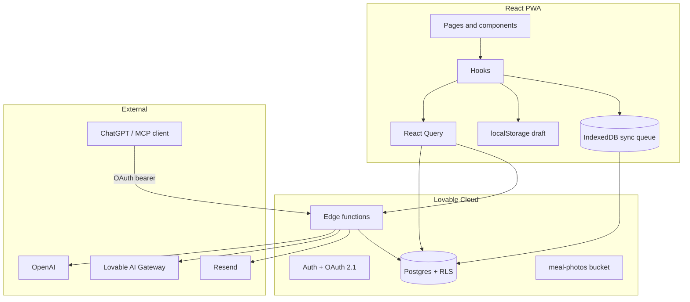
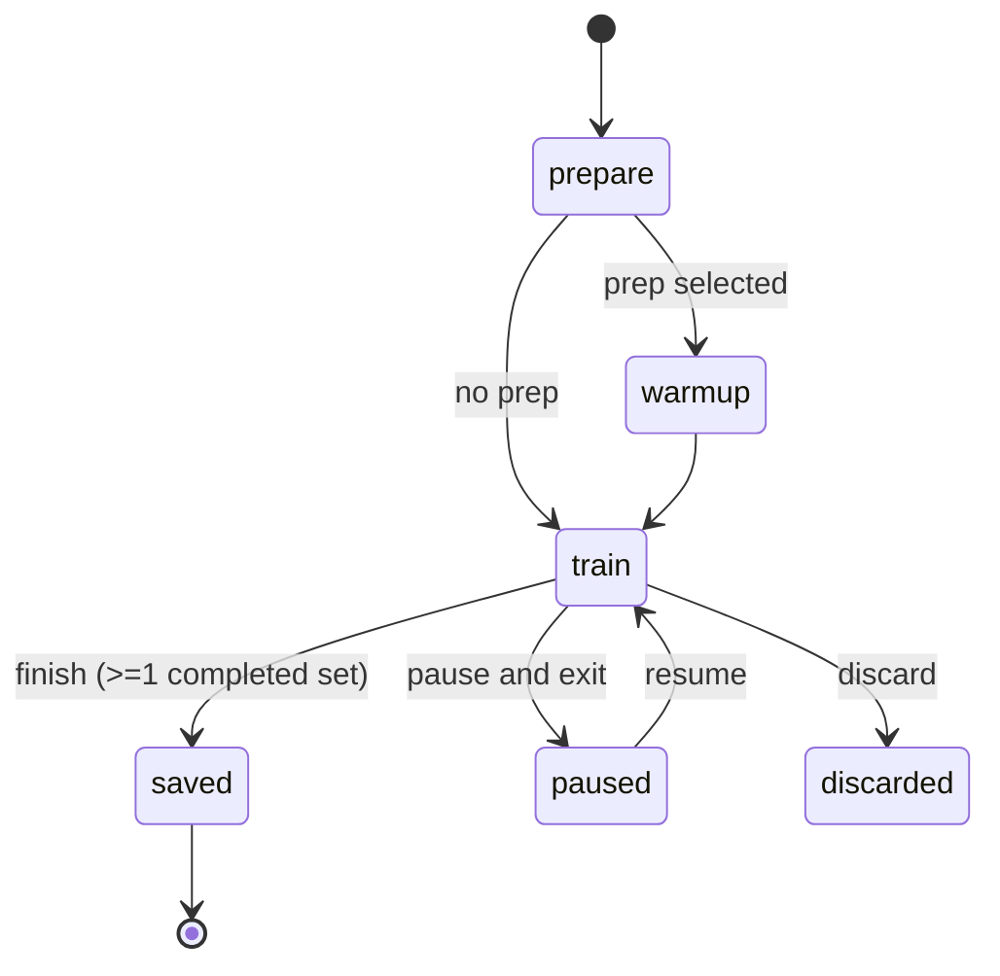

# Reptrack Fitness - Personal Health Operating System

> **App version:** 5.0 | **MCP server:** 1.2.0 | **Platform:** React PWA + Capacitor native shell
> **Production:** https://reptrack.fitness (also https://reps-and-reminders.lovable.app)
> **Last updated:** 23 August 2026

Reptrack is a single-user-per-account health operating system: training, nutrition,
hydration, bodyweight, sleep and energy balance in one mobile-first app, with a
private MCP server so ChatGPT can read your data, log on your behalf, and coach
you live during a session.

---

## Table of contents

1. [Feature inventory](#feature-inventory)
2. [Technology stack](#technology-stack)
3. [Architecture](#architecture)
4. [Database schema](#database-schema)
5. [Energy model](#energy-model)
6. [Workout engine](#workout-engine)
7. [Session durability: every scenario](#session-durability-every-scenario)
8. [MCP server](#mcp-server)
9. [Live coaching: conditions, outcomes and timing](#live-coaching-conditions-outcomes-and-timing)
10. [Edge functions](#edge-functions)
11. [Failure modes and outcomes](#failure-modes-and-outcomes)
12. [Design system](#design-system)
13. [Testing](#testing)
14. [Development and deployment](#development-and-deployment)

---

## Feature inventory

### Training
| Feature | Behaviour |
|---|---|
| Adaptive PPL engine | Six-day Push/Pull/Legs rotation with heavy and volume days; the next session is resolved from `training_state` plus your last completed workout, with a local fallback. |
| Readiness adaptation | "Feeling rough?" adjusts sets, load targets and rest for the session (green/amber/red band stored on the workout). |
| Set-by-set logging | Tap-based weight and rep chips prefilled from your prescription and last-used loads. No typing required for a normal set. |
| Warm-up stage | Optional prep block, selectable per session, skipped automatically when nothing is selected. |
| Rest timer | `Date.now()` baseline plus `visibilitychange` recovery so backgrounding the app never drifts the timer. |
| PR detection | Detected on weight increase, rep increase at equal weight, and first-ever log of a movement. Shared across exercise families. |
| Exercise families | ~190 aliases normalise to canonical names, so "Neutral-Grip Lat Pulldown" shares PRs and trend lines with "Lat Pulldown". |
| Backdating | A subtle pill on the prepare screen exposes date, start time and duration for logging a past session. |
| Live sync | While training, the session mirrors to `live_workout_sessions` for MCP readers. |
| Coach cues | Conditions armed by ChatGPT fire in-app the moment they are met. |
| History editing | Add, rename, edit and delete exercises and individual sets; edits recompute burn and refresh Insights. |
| Skip | Records a zero-duration skipped workout and advances the rotation. |

### Nutrition and energy
| Feature | Behaviour |
|---|---|
| Photo food logging | Multiple images analysed sequentially by gpt-4o vision; macro breakdown is shown for review before saving. |
| Text food logging | Natural-language parsing via gpt-4o-mini with the same review step. |
| Tracked nutrients | Calories, protein, carbs, fat, fiber, sugar, sodium, potassium (3,400 mg default), caffeine (400 mg default). |
| Deficit mode | Toggle in Settings; the dashboard switches to calories remaining, net deficit against a fixed target, and protein-first emphasis. |
| Maintenance tile | Headlines maintenance, expands to the full calculation chain, and shows a resting-burn ticker that updates every 15 seconds. |
| Activity logging | Walk, run and cycling with distance and optional time; time wins for burn when both are given. |
| Water | 250 ml, 500 ml, 750 ml and 1 L increments only. |
| Net calories | History and Insights show intake minus burn, with a Net/Split toggle. |

### Insights
Daily vitals (bodyweight and sleep), energy balance, hydration, macro charts,
volume Sankey by muscle group, exercise progression ranked by improvement,
personal records, muscle balance, body overview, correlation analysis and
AI coach insights (collapsed by default, refreshed on demand).

### Platform
PWA with prompt-style updates, IndexedDB offline mutation queue with replay,
NetworkFirst caching, haptics, safe-area handling, CSV export of the full
account, and one-tap account deletion.

---

## Technology stack

**Frontend:** React 18.3, TypeScript 5, Vite 5, MUI 7, Tailwind 3, Framer Motion 12,
React Router 6, TanStack Query 5, Recharts 2.

**Backend (Lovable Cloud):** Postgres with RLS on every table, Supabase Auth
(email/password plus Google and Apple), private `meal-photos` storage bucket,
Deno edge functions, Supabase OAuth 2.1 authorization server with dynamic client
registration.

**AI:** OpenAI gpt-4o (food vision), gpt-4o-mini (workout generation, food text),
Lovable AI Gateway gemini-2.5-flash (coach insights).

**Native:** Capacitor 8 for iOS and Android shells.

---

## Architecture



### Directory map

```
src/
├── pages/          Dashboard, AdaptiveWorkout, LogWorkout, Insights, History,
│                   WorkoutDetail, Settings, Dataroom, LifecycleTracker,
│                   McpStatus, OAuthConsent, Landing, Changelog, Privacy
├── components/     dashboard, health, workout, analytics, adaptive, layout,
│                   settings, landing, pwa, ui
├── hooks/          37 hooks (data, drafts, energy, live session, offline sync)
├── lib/            energy engine, exercise matching/families/library,
│                   programming engine, workout triggers, calories, export
├── contexts/       Theme, DateRange, LogDate
└── theme/          MUI theme

supabase/functions/
├── mcp/            MCP server: index, core, data, writes, live, energy
├── ai-coach/       Gemini coaching insights
├── analyze-food/   gpt-4o vision macro extraction
├── parse-food-text/ gpt-4o-mini text macro extraction
├── generate-workout/ AI routine builder
├── send-auth-email/ Resend transactional email
└── _shared/        rate limiting helper
```

---

## Database schema

All tables are RLS-scoped to `auth.uid()`. No table is readable by `anon`.

| Table | Purpose |
|---|---|
| `profiles` | Minimal profile row created by the `handle_new_user` trigger. No PII. |
| `user_preferences` | Goals, targets, split, deficit mode, macro goals, locks. |
| `workouts` | Sessions: date, day, session_key, duration, started/completed, pause seconds, energy fields, readiness band, completion percent. |
| `exercises` | Per-exercise rows with string weight/rep lists and prescription JSON. |
| `exercise_sets` | Normalised set rows with template linkage and muscle metadata. |
| `exercise_templates` | User exercise library with canonical names and movement patterns. |
| `live_workout_sessions` | One row per user mirroring the in-progress session, plus `coach_note`. |
| `workout_triggers` | Assistant-armed in-session cues with condition, threshold, comparator, status. |
| `workout_pauses` | Explicit pause intervals for accurate duration. |
| `daily_metrics` | Bodyweight, sleep, rest-day flag, notes. |
| `meals` | Calories and nine tracked nutrients, photo URL, AI confidence, source metadata. |
| `water_logs` | Hydration events. |
| `calorie_burns` | Workout and activity burn with MET, intensity band, model version and inputs. |
| `energy_model_states` | Point-in-time snapshot of the personal energy model. |
| `energy_targets` | Generated calorie and protein targets with basis and reason. |
| `goal_history` | Point-in-time goal values so past days are never rewritten. |
| `adaptive_lifecycles` / `adaptive_session_logs` | Variation lifecycles and progression logs. |
| `readiness_checkins`, `post_workout_checkins`, `physique_checkins`, `mobility_assessments`, `recovery_metrics`, `deload_weeks` | Check-in and recovery data. |
| `custom_routines` | User routines; a trigger enforces a single active routine. |
| `training_state` | Next session pointer and deload flag. |
| `mcp_audit_logs` | Sanitised MCP call log: tool, duration, success, error category. Insert-only from the server, read-only to the user. |
| `api_rate_limits` | Rate-limit buckets for AI functions. |

Security-definer functions: `has_role`-style access is not used (single-user
data model); `check_rate_limit`, `check_email_exists`, `delete_my_account`,
`handle_new_user`, `ensure_single_active_routine`, `update_updated_at_column`.

---

## Energy model

Version 3, computed in `src/lib/energyEngineV3.ts` and mirrored in
`supabase/functions/mcp/energy.ts` so app-side and MCP-side writes agree.

```
REE          = Mifflin-St Jeor from age, sex, height, effective weight
baseline     = REE × nonexercise lifestyle factor
maintenance  = baseline + calibration adjustment (multi-week, quality gated)
activity     = MET × effective weight kg × hours, counted net of rest
net calories = intake − (maintenance + activity burn)
```

MET values: walking 3.5, running scaled by pace, cycling by intensity,
resistance training banded by session intensity (roughly 4.0 accessory,
5.0 push/pull, 6.0 legs). Every burn row stores its inputs and model version,
so recalculating history is reproducible and edits stay consistent.

Calibration only runs when data quality gates pass (enough logged days,
plausible intake, stable weight trend); otherwise the formula baseline stands
and confidence is reported as low.

---

## Workout engine



- **Finish** appears only on the last set of the current last exercise, and
  re-evaluates when the exercise list is edited mid-session.
- **Save is idempotent.** A stable `clientId` is generated per session and
  reused on retry, so a failed save that partially wrote never duplicates.
- **Rotation** advances only after a successful save; a failed save keeps the
  draft and the current session key.

---

## Session durability: every scenario

| Scenario | Outcome |
|---|---|
| Navigate to another tab mid-set | Leave prompt: Pause and exit (saves draft, ends the live row, returns you to the app), Keep going, or Discard. |
| Tap Resume on the dashboard card | Returns to the exact screen, exercise index and set index you left, with the timer reconstructed from `workoutStartTime`. |
| App backgrounded on iOS | `visibilitychange` flushes the draft immediately; the timer recomputes from wall-clock on return. |
| Tab or browser closed | `pagehide` and `beforeunload` flush the draft; a confirmation dialog appears during an active session. |
| Force-killed app | A 5-second interval flush means at most 5 seconds of taps are lost. |
| Offline mid-session | Sets stay in the local draft; the save is queued in IndexedDB and replayed when connectivity returns. |
| Save fails (network or server) | Draft is preserved, an explicit error toast names the reason, and tapping finish again retries with the same `clientId`. |
| Draft older than 24 hours | Discarded on load; staleness is measured from `lastSavedAt`, never from a backdated workout date. |
| Backdated session | Start time and duration are taken from the manual inputs; burn is scaled to that duration. |
| Two devices | The draft is per-device local storage; the live session row is per-user and last-write-wins. |

---

## MCP server

Endpoint: `https://<project>.supabase.co/functions/v1/mcp`
Transport: Streamable HTTP. Auth: Supabase OAuth 2.1 with PKCE and dynamic
client registration; consent is served in-app at `/.lovable/oauth/consent`.
Health: `GET /mcp/health`.

### Read tools (12)
`get_fitness_profile`, `get_bodyweight_history`, `get_workouts`,
`get_exercise_history`, `get_training_summary`, `get_nutrition`, `get_sleep`,
`get_activity`, `get_progress_summary`, `get_recent_fitness_data`,
`get_live_workout`, `list_workout_triggers`.

### Write tools (10)
`log_meal`, `update_meal`, `log_water`, `log_workout`, `update_workout`,
`log_activity`, `update_activity`, `set_workout_trigger`,
`cancel_workout_trigger`, `send_coach_note`.

### Rules and guarantees
- No date-range limits on reads or writes. Future dates are rejected; malformed
  dates are rejected. There is no backdating cap.
- No rate limits, so long ChatGPT sessions are not cut off.
- No delete tools and no goal mutation. The worst case for a write is an
  incorrect row you can edit in History.
- `log_workout` accepts any string as `client_key` and hashes it to a stable
  UUID, making retries idempotent.
- Writes reuse the app energy model, so burn totals agree with the UI.
- Responses are capped at 400 KB, truncating the `data` array and flagging
  `metadata.truncated` rather than breaking the client.
- Transient database errors retry with backoff; deterministic errors fail fast
  with a stable category (`PERMISSION_DENIED`, `QUERY_TIMEOUT`,
  `DATABASE_UNAVAILABLE`, and so on).
- Every call writes a sanitised row to `mcp_audit_logs`, visible on the MCP
  status page.

---

## Live coaching: conditions, outcomes and timing

While a session is running the app publishes current exercise, exercise and set
index, completed sets, total sets, session volume, elapsed seconds and the full
exercise list. Publishing is de-duplicated by payload fingerprint and elapsed
time is bucketed to 15 seconds, so a quiet session writes rarely.

### Trigger conditions

| Condition | Fires when | Needs |
|---|---|---|
| `exercise_started` | You reach a matching exercise | exercise name |
| `weight_at_least` | Last completed set on that exercise meets the threshold | exercise name, threshold |
| `reps_at_least` | Last completed set on that exercise meets the threshold | exercise name, threshold |
| `elapsed_minutes` | Session elapsed time crosses the threshold | threshold |
| `completed_sets` | Completed set count crosses the threshold | threshold |
| `session_volume` | Total volume crosses the threshold | threshold |

Each trigger carries a comparator (`gte` or `lte`), a `repeat_mode`
(`once` or `always`), an optional expiry up to 72 hours, and a message.
Exercise matching is fuzzy in both directions, so a cue on "Lat Pulldown"
matches "Neutral-Grip Lat Pulldown" and vice versa.

### Timing and cases

| Case | Outcome |
|---|---|
| Pre-armed cue met | Evaluated locally against every set change. Banner appears immediately, with no network round trip, and works if ChatGPT is closed. |
| Cue already fired, `repeat_mode: once` | Never fires again; status becomes `fired`. |
| Cue with `repeat_mode: always` | Fires on every subsequent match. |
| Cue expired or cancelled | Never fires. |
| Ad-hoc `send_coach_note` | The app polls every 20 seconds, so the note lands within that window. |
| Note dismissed | Cleared from the live row so it does not reappear. |
| No active session | `get_live_workout` returns `live: false`; `send_coach_note` fails rather than queuing. |
| Session ends (save, discard, pause and exit) | The live row is marked `ended` and stops being readable as live. |
| Two cues match at once | Both are evaluated; one banner is shown at a time, the next appears after dismissal. |

The important limitation: ChatGPT does not watch on its own. It reads the
session only when prompted. Arm cues up front for genuinely instant reactions;
ad-hoc notes need someone to poke the assistant.

---

## Edge functions

| Function | Auth | Purpose |
|---|---|---|
| `mcp` | OAuth 2.1 bearer, validated in code (`verify_jwt = false`) | The MCP server. |
| `analyze-food` | JWT validated in code | gpt-4o vision macro extraction, 15/min. |
| `parse-food-text` | JWT validated in code | gpt-4o-mini text macros, 20/min. |
| `generate-workout` | JWT validated in code | AI routine builder, 5/min. |
| `ai-coach` | JWT validated in code | Gemini insight generation, 10/min. |
| `send-auth-email` | Webhook | Resend transactional email. |

Auth is validated by a direct call to `/auth/v1/user` rather than the SDK
`getUser()`, which proved unstable under the signing-keys system.

---

## Failure modes and outcomes

| Failure | What the user sees | Data outcome |
|---|---|---|
| Food photo analysis fails | Retry after 1.5 s, then a clear error | Nothing written; the photo stays queued for retry |
| AI returns incomplete macros | Rejected by strict validation | Nothing written |
| Workout save fails | Error toast naming the cause, sets preserved | Draft retained, retry is idempotent |
| Partial workout write | Sets kept, save retried | No duplicate workout thanks to `clientId` |
| Offline mutation | Queued silently, offline banner shown | Replayed in order on reconnect |
| MCP database error | Tool returns `isError` with a stable category and `retryable` flag | Nothing written on failure |
| MCP oversized response | `metadata.truncated: true` with a returned count | Client stays functional |
| OAuth consent declined | Redirect back to the client with a denial | No token issued |
| Rate limit hit on AI functions | Explicit JSON error surfaced in the UI | Nothing written |
| Account deletion | Immediate sign-out | Every user row and the auth user are deleted in one transaction |

---

## Design system

Dark-first "Dark AF" palette: `#050505` background, `#0f0f0f` surfaces,
high-contrast text, muted coral and mint accents reserved for charts.
Space Grotesk for headings and branding, Inter for body. Global `rounded-xl`,
headerless layouts, brutalist buttons, no em dashes, no ALL-CAPS body copy.
All colours are semantic tokens in `src/index.css`; contrast was audited across
both themes for legibility.

---

## Testing

Vitest covers the pure logic layers: energy engine v3, workout calories, energy
sync, exercise classification, matching, families, variants, preferences,
personal records, exercise sets, adaptive engine and roster, programming engine,
body score, history calories, day activity, data export, draft workout, workout
saving, dataroom analysis and temporal logic, MCP security, and workout triggers.

```bash
bunx vitest run
```

---

## Development and deployment

```bash
npm install
npm run dev        # http://localhost:8080
npm run build
```

Environment variables (`VITE_SUPABASE_URL`, `VITE_SUPABASE_PUBLISHABLE_KEY`,
`VITE_SUPABASE_PROJECT_ID`) are managed automatically. Edge function secrets
live in Lovable Cloud: `OPENAI_API_KEY`, `LOVABLE_API_KEY`, `RESEND_API_KEY`.

Deploy the web app by publishing from Lovable. Native builds use Capacitor
(`npx cap sync`). Custom domain: reptrack.fitness.

After any change to the MCP server, redeploy the `mcp` edge function; the live
endpoint reflects nothing until it is redeployed.
