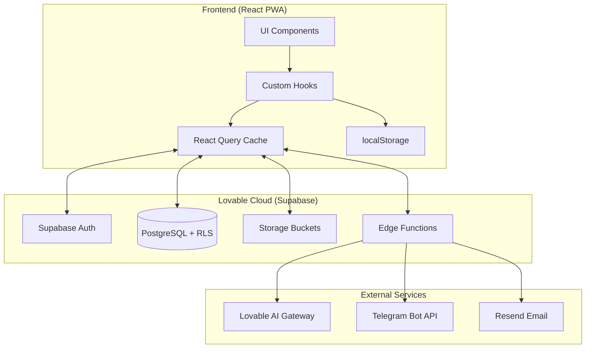
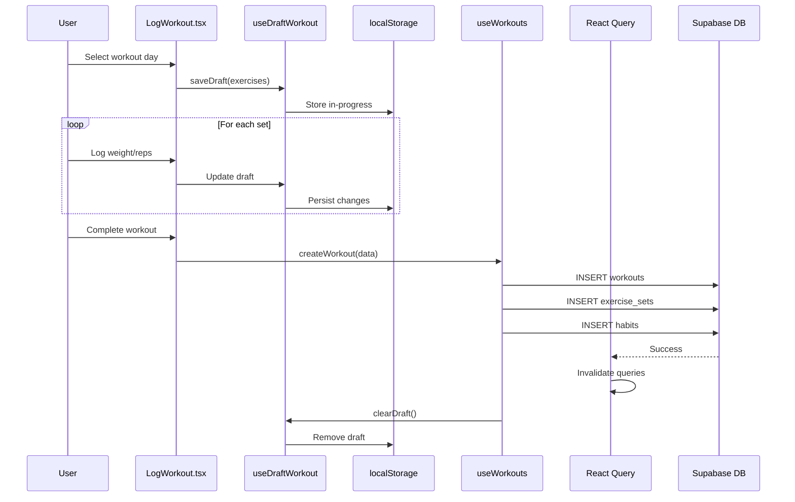
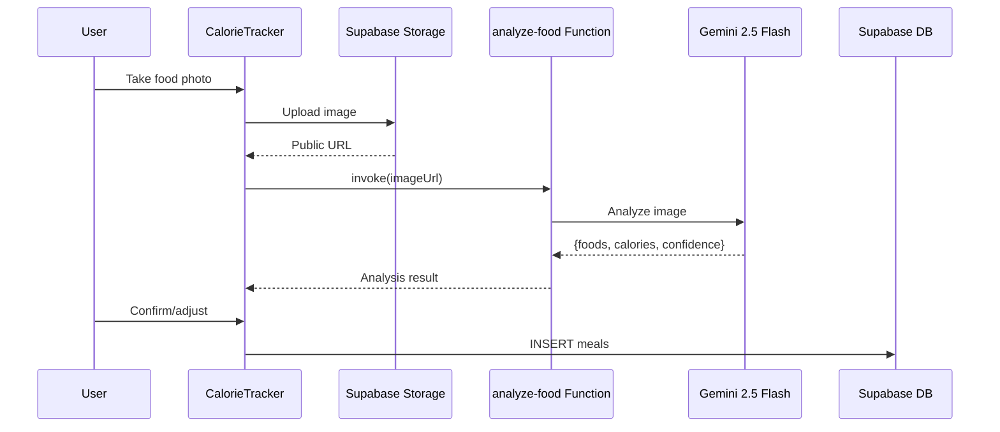
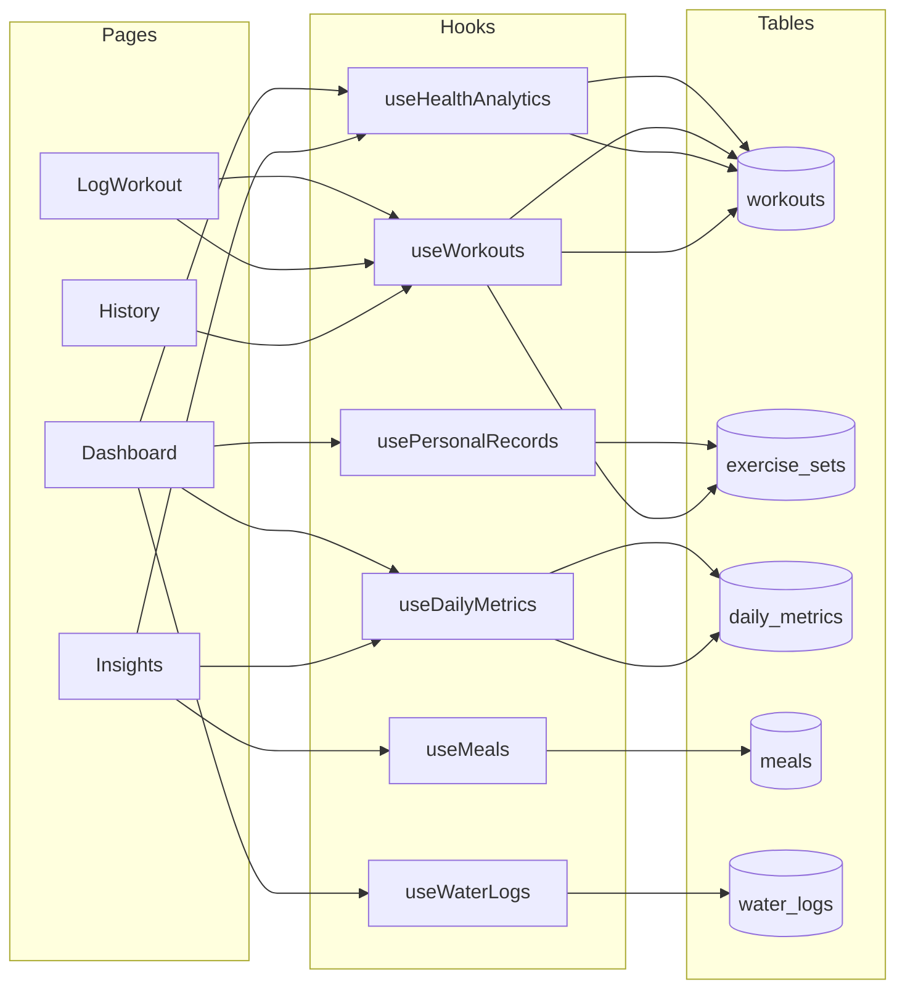
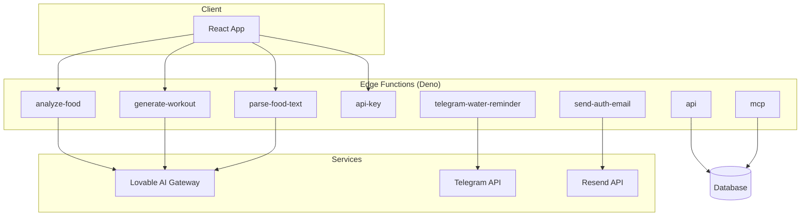

# HEALTH/OS - Complete Project Documentation

> **Version:** 1.0.0  
> **Last Updated:** January 2026  
> **Platform:** Progressive Web App (PWA) + Capacitor Native

---

## Table of Contents

1. [Project Overview](#project-overview)
2. [Technology Stack](#technology-stack)
3. [Architecture](#architecture)
4. [Database Schema](#database-schema)
5. [Authentication Flow](#authentication-flow)
6. [User Flows](#user-flows)
7. [Core Hooks](#core-hooks)
8. [Components](#components)
9. [Edge Functions](#edge-functions)
10. [Design System](#design-system)
11. [Data Models](#data-models)
12. [API Reference](#api-reference)
13. [Performance Optimizations](#performance-optimizations)
14. [Deployment](#deployment)

---

## Project Overview

**HEALTH/OS** is a comprehensive personal health operating system that centralizes fitness tracking, nutrition logging, vitals monitoring, and workout planning into a single mobile-first PWA.

### Core Features
- **Workout Logging**: Set-by-set exercise tracking with progressive overload
- **Nutrition Tracking**: AI-powered food analysis from photos + manual calorie logging
- **Hydration**: Water intake tracking with Telegram reminder integration
- **Daily Check-ins**: Morning/night vitals logging (sleep, energy, weight, steps)
- **Analytics**: Strength progression, body composition, correlation insights
- **AI Workout Generation**: Personalized PPL routines based on goals
- **Personal Records**: Automatic PR detection across all exercises

### Vision
The app serves as a "Personal Health Operating System" - a unified dashboard for all health metrics with time-aware check-ins and long-term trend analysis.

---

## Technology Stack

### Frontend
| Technology | Version | Purpose |
|------------|---------|---------|
| **React** | ^18.3.1 | UI library |
| **TypeScript** | ^5.x | Type safety |
| **Vite** | ^5.x | Build tool & dev server |
| **Material UI (MUI)** | ^7.3.7 | UI component framework |
| **Tailwind CSS** | ^3.x | Utility CSS |
| **Framer Motion** | ^12.29.2 | Animations |
| **React Router** | ^6.30.1 | Client-side routing |
| **TanStack React Query** | ^5.83.0 | Server state management |
| **Recharts** | ^2.15.4 | Data visualization |

### Backend (Lovable Cloud / Supabase)
| Technology | Purpose |
|------------|---------|
| **Supabase Auth** | Email/password authentication |
| **Supabase Database** | PostgreSQL with RLS policies |
| **Supabase Storage** | Meal photo uploads |
| **Edge Functions (Deno)** | AI integration, notifications |

### Native (Capacitor)
| Package | Purpose |
|---------|---------|
| **@capacitor/core** | ^8.0.1 | Native bridge |
| **@capacitor/ios** | ^8.0.1 | iOS platform |
| **@capacitor/android** | ^8.0.1 | Android platform |
| **@perfood/capacitor-healthkit** | ^1.3.2 | HealthKit integration |

### Key Dependencies
```json
{
  "@emotion/react": "^11.14.0",      // MUI styling
  "@emotion/styled": "^11.14.1",     // MUI styled components
  "@supabase/supabase-js": "^2.90.0", // Supabase client
  "date-fns": "^3.6.0",              // Date manipulation
  "lucide-react": "^0.462.0",        // Icons
  "sonner": "^1.7.4",                // Toast notifications
  "zod": "^3.25.76",                 // Schema validation
  "react-hook-form": "^7.61.1",      // Form handling
  "vaul": "^0.9.9"                   // Drawer component
}
```

---

## Architecture

### Directory Structure
```
src/
├── App.tsx                    # Root component with providers
├── main.tsx                   # Entry point
├── index.css                  # Global styles & CSS variables
│
├── pages/                     # Route components
│   ├── Index.tsx              # Auth gate + onboarding + dashboard
│   ├── Dashboard.tsx          # Main dashboard view
│   ├── LogWorkout.tsx         # Workout logging wizard
│   ├── CreateRoutine.tsx      # AI routine generator
│   ├── Insights.tsx           # Analytics & charts
│   ├── History.tsx            # Workout history list
│   ├── WorkoutDetail.tsx      # Single workout view
│   ├── Settings.tsx           # User preferences
│   └── NotFound.tsx           # 404 page
│
├── components/
│   ├── auth/                  # Auth forms
│   ├── dashboard/             # Dashboard widgets
│   ├── health/                # Check-in cards, nutrition
│   ├── analytics/             # Charts & insights
│   ├── workout/               # Exercise logging components
│   ├── onboarding/            # Onboarding flow
│   ├── layout/                # Header, BottomNav, MainLayout
│   ├── settings/              # Settings sections
│   └── ui/                    # shadcn/ui primitives
│
├── hooks/                     # Custom React hooks
├── contexts/                  # React contexts (Theme, DateRange)
├── integrations/supabase/     # Auto-generated Supabase types
├── lib/                       # Utilities (exercise library, haptics)
└── theme/                     # MUI theme configuration

supabase/
├── config.toml                # Supabase configuration
└── functions/                 # Edge functions (Deno)
    ├── analyze-food/          # AI food image analysis
    ├── generate-workout/      # AI workout generation
    ├── parse-food-text/       # Natural language food parsing
    ├── api-key/               # User API key management
    ├── api/                   # Public MCP API
    ├── mcp/                   # Model Context Protocol
    ├── send-auth-email/       # Custom auth emails via Resend
    └── telegram-water-reminder/ # Telegram bot integration
```

### Provider Hierarchy
```tsx
<QueryClientProvider>
  <ThemeProvider>        {/* Light/dark mode */}
    <MuiThemeProvider>   {/* MUI theming */}
      <CssBaseline />
      <BrowserRouter>
        <Routes />
      </BrowserRouter>
    </MuiThemeProvider>
  </ThemeProvider>
</QueryClientProvider>
```

### State Management
- **Server State**: TanStack React Query for all Supabase data
- **Local State**: React useState/useReducer
- **Draft Persistence**: localStorage for in-progress workouts
- **Auth State**: Supabase auth listener in `useAuth` hook

---

## Architecture Diagrams

### High-Level System Architecture



### Data Flow: Workout Logging



### Data Flow: AI Food Analysis



### Component-Hook-Database Relationships



### Authentication & Authorization Flow

```mermaid
flowchart TD
    Start([App Launch]) --> Check{Session exists?}
    Check -->|No| Auth[AuthForm]
    Check -->|Yes| Prefs{Preferences exist?}
    
    Auth -->|Sign Up| Create[Create Account]
    Auth -->|Sign In| Login[Authenticate]
    Create --> AutoConfirm[Auto-confirm Email]
    AutoConfirm --> Prefs
    Login --> Prefs

    Prefs -->|No/Not Complete| Onboard[OnboardingFlow]
    Prefs -->|Yes| Dashboard[Dashboard]
    Onboard --> SavePrefs[Save Preferences]
    SavePrefs --> Dashboard

    subgraph RLS["Row Level Security"]
        Dashboard -->|All Queries| RLSCheck{auth.uid() = user_id?}
        RLSCheck -->|Yes| Data[(User's Data)]
        RLSCheck -->|No| Denied[Access Denied]
    end
```

### Edge Function Architecture



---

## Database Schema

### Tables Overview

| Table | Purpose | Key Columns |
|-------|---------|-------------|
| `profiles` | User profile data | id, email |
| `user_preferences` | Onboarding & goals | water_goal, calorie_goal, sleep_goal |
| `workouts` | Workout sessions | date, day, day_name, duration, checkin scores |
| `exercises` | Legacy exercise records | name, category, weight, reps |
| `exercise_sets` | Normalized set data | exercise_name, set_number, weight, reps |
| `exercise_templates` | User custom exercises | name, muscles, equipment |
| `habits` | Workout-linked habits | pullups, water, sleep, supplements |
| `daily_metrics` | Daily health data | sleep, energy, bodyweight, supplements |
| `morning_checkins` | AM vitals | sleep_time, wake_time, energy, heart_rate |
| `night_checkins` | PM vitals | performance, steps, is_rest_day |
| `meals` | Food logs | calories, protein, carbs, fat, photo_url |
| `calorie_burns` | Exercise calories | source, calories, duration |
| `water_logs` | Hydration tracking | amount, timestamp, method |
| `blood_pressure_readings` | BP vitals | systolic, diastolic, pulse |
| `blood_sugar_readings` | Glucose vitals | glucose_level, reading_type |
| `custom_routines` | AI-generated routines | routine_name, routine_data (JSON) |
| `recovery_metrics` | Recovery tracking | hrv, sleep_quality, fatigue |
| `deload_weeks` | Deload scheduling | week_start, week_end, reduction % |
| `api_keys` | User API keys | api_key, last_used_at |
| `water_reminder_configs` | Telegram reminders | telegram_username, frequency |

### Row-Level Security (RLS)

All tables use RLS with policies following this pattern:
```sql
-- Users can only access their own data
CREATE POLICY "Users can view own [table]"
ON public.[table]
FOR SELECT
USING (auth.uid() = user_id);

CREATE POLICY "Users can create own [table]"
ON public.[table]
FOR INSERT
WITH CHECK (auth.uid() = user_id);

CREATE POLICY "Users can update own [table]"
ON public.[table]
FOR UPDATE
USING (auth.uid() = user_id);

CREATE POLICY "Users can delete own [table]"
ON public.[table]
FOR DELETE
USING (auth.uid() = user_id);
```

### Key Relationships
```
workouts (1) ──────┬──── (N) exercises
                   ├──── (N) exercise_sets
                   └──── (1) habits

user (1) ──────────┬──── (N) workouts
                   ├──── (N) daily_metrics
                   ├──── (N) meals
                   ├──── (N) water_logs
                   ├──── (N) morning_checkins
                   ├──── (N) night_checkins
                   ├──── (1) user_preferences
                   └──── (1) profiles
```

---

## Authentication Flow

### Implementation: `src/hooks/useAuth.ts`

```typescript
interface AuthAPI {
  user: User | null;
  session: Session | null;
  loading: boolean;
  signUp(email: string, password: string): Promise<AuthResponse>;
  signIn(email: string, password: string): Promise<AuthResponse>;
  signOut(): Promise<void>;
  resetPassword(email: string): Promise<void>;
  updateEmail(newEmail: string): Promise<void>;
  updatePassword(newPassword: string): Promise<void>;
}
```

### Flow Sequence

```
App Launch
    │
    ▼
┌─────────────────┐
│ Check Session   │ ◄── supabase.auth.getSession()
└────────┬────────┘
         │
    ┌────┴────┐
    ▼         ▼
 No Auth    Has Auth
    │         │
    ▼         ▼
┌────────┐  ┌──────────────────┐
│AuthForm│  │Check Preferences │
└────────┘  └────────┬─────────┘
                     │
              ┌──────┴──────┐
              ▼             ▼
         No Prefs      Has Prefs
              │             │
              ▼             ▼
      ┌────────────┐  ┌──────────┐
      │Onboarding  │  │Dashboard │
      └────────────┘  └──────────┘
```

### Auth Configuration
- Email confirmation: **Auto-confirmed** (no email verification)
- Password reset: Uses Supabase + Resend fallback

---

## User Flows

### 1. New User Onboarding

```
Step 1: Goal Selection
├── Lose Weight
├── Maintain
└── Build Muscle

Step 2: Hydration Goal
└── Slider: 1L - 5L (default 3L)

Step 3: Training & Nutrition
├── Workouts per week: 1-7 (default 4)
└── Daily calories: 1200-4000 (default 2000)

Step 4: Recovery
└── Sleep goal: 5-10h (default 8h)

→ Save to user_preferences
→ Redirect to Dashboard
```

### 2. Workout Logging Flow

```
Select Day (Push A, Pull A, etc.)
    │
    ▼
Exercise List
├── Pre-populated from routine OR manual selection
├── For each exercise:
│   └── For each set:
│       ├── Enter weight + reps
│       └── Mark complete
│
└── All exercises done
        │
        ▼
Post-Workout Check-in
├── Difficulty (1-10)
├── Satisfaction (1-10)
└── Duration (auto-calculated or manual)
        │
        ▼
Save to DB
├── workouts table
├── exercise_sets table
└── Invalidate queries
```

### 3. Meal Logging Flow

```
Photo Method:
├── Take/upload photo
├── Upload to Supabase Storage
├── Call analyze-food edge function
├── Display AI estimate
├── User confirms/adjusts
└── Save to meals table

Text Method:
├── Enter natural language ("2 tacos and a coke")
├── Call parse-food-text edge function
├── Display parsed items
└── Save to meals table

Manual Method:
├── Enter food name
├── Enter macros (cal, protein, carbs, fat)
└── Save to meals table
```

### 4. Daily Check-in Flow

```
Morning (time-aware, before 12 PM):
├── Sleep time + wake time
├── Energy level (1-5)
├── Body weight
├── Heart rate (optional)
└── Save to morning_checkins

Night (after 6 PM):
├── Performance score (1-5)
├── Energy score (1-5)
├── Steps count
├── Is rest day?
└── Save to night_checkins
```

---

## Core Hooks

### Authentication & User
| Hook | Purpose |
|------|---------|
| `useAuth` | Auth state, signIn/signUp/signOut |
| `useUserPreferences` | Goals, onboarding status |

### Workout Data
| Hook | Purpose |
|------|---------|
| `useWorkouts` | CRUD workouts, list history |
| `useExerciseSets` | Query normalized set data |
| `useDraftWorkout` | localStorage persistence for in-progress |
| `useLastUsedWeights` | Pre-fill weights from last session |
| `usePersonalRecords` | Calculate and track PRs |
| `useWorkoutDetails` | Single workout with exercises |

### Health Data
| Hook | Purpose |
|------|---------|
| `useDailyMetrics` | Daily health data (sleep, weight, etc.) |
| `useMorningCheckin` | AM check-in CRUD |
| `useNightCheckin` | PM check-in CRUD |
| `useMeals` | Meal/nutrition CRUD |
| `useCalorieBurn` | Calorie expenditure tracking |
| `useWaterLogs` | Water intake tracking |
| `useHydrationData` | Aggregated hydration analytics |

### Analytics
| Hook | Purpose |
|------|---------|
| `useHealthAnalytics` | Dashboard stats (streaks, PRs) |
| `useHealthInsights` | AI-generated health insights |
| `useCorrelationAnalysis` | Sleep/energy correlations |
| `useVolumeData` | Volume trends over time |
| `useBodyPartsProgress` | Muscle group progression |
| `useMLInsights` | Machine learning predictions |

### Utilities
| Hook | Purpose |
|------|---------|
| `useTheme` | Dark/light mode toggle |
| `useTimezone` | User timezone handling |
| `useAutoMetrics` | Auto-calculate workout duration |
| `useDataExport` | Export data as JSON/CSV |

---

## Components

### Dashboard Widgets
| Component | Purpose |
|-----------|---------|
| `ProgressHeader` | Weekly progress ring + streak |
| `QuickActionsBar` | Quick log buttons |
| `TodayStats` | Horizontal scroll stats |
| `DailyRitualCard` | Time-aware check-in prompt |
| `WaterTracker` | Hydration progress + log |
| `CalorieTrackerCompact` | Calorie in/out summary |
| `PersonalRecords` | Latest PRs list |
| `RecentActivity` | Last 5 workouts |
| `Heatmap` | Workout frequency calendar |

### Analytics Charts
| Component | Purpose |
|-----------|---------|
| `StrengthOverviewChart` | Muscle group sparkline grid |
| `BodyweightChart` | Weight trend line |
| `SleepEnergyChart` | Sleep + energy correlation |
| `HydrationChart` | Water intake bar chart |
| `VolumeSankeyChart` | Volume flow diagram |
| `SupplementAdherence` | Supplement consistency |
| `EfficiencyChart` | Workout efficiency metrics |
| `MLCoachInsights` | AI recommendations |

### Workout Components
| Component | Purpose |
|-----------|---------|
| `DaySelector` | Workout day picker |
| `ExerciseList` | Exercise grid with sets |
| `SetBySetCard` | Individual exercise logging |
| `SingleExerciseCard` | Quick single-exercise mode |
| `ExercisePicker` | Add exercise modal |
| `PostWorkoutCheckin` | Post-workout survey |

### Layout
| Component | Purpose |
|-----------|---------|
| `MainLayout` | App shell with header + nav |
| `BottomNav` | Fixed bottom navigation |
| `Header` | Page header with actions |
| `AnimatedPage` | Page transition wrapper |

---

## Edge Functions

### `analyze-food`
**Purpose**: AI-powered food image analysis  
**Model**: `google/gemini-2.5-flash`  
**Input**: `{ imageUrl: string }`  
**Output**:
```json
{
  "foods": [{ "name": "...", "portion": "...", "calories": 300 }],
  "total_calories": 650,
  "confidence": 0.85,
  "description": "Chicken salad with dressing"
}
```

### `generate-workout`
**Purpose**: AI workout routine generation  
**Model**: `google/gemini-2.5-flash`  
**Input**: `{ goals: string }`  
**Output**:
```json
{
  "routine": {
    "routineName": "12-Week Strength Program",
    "days": {
      "Day 1": {
        "name": "Push A",
        "focus": "Chest & Shoulders",
        "exercises": [...]
      }
    }
  }
}
```

### `parse-food-text`
**Purpose**: Natural language food parsing  
**Input**: `{ text: "2 tacos and a coke" }`  
**Output**: Parsed food items with estimated calories

### `api-key`
**Purpose**: User API key management  
**Methods**: GET (retrieve), POST (regenerate)  
**Format**: `ftrk_[32 alphanumeric chars]`

### `telegram-water-reminder`
**Purpose**: Send water reminders via Telegram bot  
**Required Secret**: `TELEGRAM_BOT_TOKEN`

### `send-auth-email`
**Purpose**: Custom auth emails via Resend  
**Required Secret**: `RESEND_API_KEY`

---

## Design System

### Color Tokens (index.css)
```css
:root {
  --background: 0 0% 100%;        /* White */
  --foreground: 0 0% 3.9%;        /* Near black */
  --card: 0 0% 100%;
  --primary: 0 0% 9%;             /* Dark gray */
  --secondary: 0 0% 96.1%;        /* Light gray */
  --muted: 0 0% 96.1%;
  --accent: 0 0% 96.1%;
  --destructive: 0 84.2% 60.2%;   /* Red */
  --border: 0 0% 89.8%;
  --ring: 0 0% 3.9%;
}

.dark {
  --background: 0 0% 3.9%;
  --foreground: 0 0% 98%;
  /* ... inverted values */
}
```

### Typography
- **Font**: System font stack (no custom fonts)
- **Headings**: `font-bold tracking-tight`
- **Mono**: `font-mono uppercase tracking-wider`

### MUI Theme (`src/theme/muiTheme.ts`)
```typescript
const lightTheme = createTheme({
  palette: {
    mode: 'light',
    primary: { main: '#171717' },
    background: { default: '#ffffff', paper: '#ffffff' },
  },
  shape: { borderRadius: 16 },
  typography: { fontFamily: 'system-ui, sans-serif' },
});
```

### Animation Presets
```typescript
const staggerContainer = {
  hidden: { opacity: 0 },
  show: {
    opacity: 1,
    transition: { staggerChildren: 0.1 }
  }
};

const staggerItem = {
  hidden: { opacity: 0, y: 20 },
  show: { opacity: 1, y: 0 }
};
```

---

## Data Models

### Workout Exercise
```typescript
interface WorkoutExercise {
  id?: string;
  name: string;
  category: string; // 'Push' | 'Pull' | 'Legs'
  sets: ExerciseSet[];
  sort_order: number;
}

interface ExerciseSet {
  setNumber: number;
  targetWeight: string;
  targetReps: string;
  actualWeight: string;
  actualReps: string;
  completed: boolean;
}
```

### Habits & Supplements
```typescript
interface Habits {
  pullups: number;
  water_intake: number;
  sleep_hours: number;
  energy_level: number;
  bodyweight?: number;
  notes?: string;
  supplements: {
    whey: boolean;
    casein: boolean;
    creatine: boolean;
    omega3: boolean;
    vitaminD: boolean;
    magnesium: boolean;
    zinc: boolean;
  };
}
```

### User Preferences
```typescript
interface UserPreferences {
  onboarding_completed: boolean;
  daily_water_goal: number;      // liters
  daily_calorie_goal: number;    // kcal
  weekly_workout_goal: number;   // 1-7
  sleep_goal: number;            // hours
  weight_goal: number | null;    // kg
  weight_goal_type: 'lose' | 'gain' | 'maintain' | null;
  units_system: 'metric' | 'imperial';
}
```

---

## API Reference

### Supabase Client
```typescript
import { supabase } from "@/integrations/supabase/client";

// Query
const { data, error } = await supabase
  .from('workouts')
  .select('*')
  .eq('user_id', userId)
  .order('date', { ascending: false });

// Insert
const { data, error } = await supabase
  .from('meals')
  .insert({ user_id, date, calories, meal_type })
  .select()
  .single();

// Upsert
const { error } = await supabase
  .from('daily_metrics')
  .upsert({ user_id, date, bodyweight }, { onConflict: 'user_id,date' });

// Edge function
const { data, error } = await supabase.functions.invoke('analyze-food', {
  body: { imageUrl }
});
```

### Query Keys Convention
```typescript
// Pattern: [entity, userId, ...filters]
['workouts', userId]
['workout-details', workoutId]
['daily-metrics', userId, dateStr]
['meals', userId, dateStr]
['water-logs', userId, startDate, endDate]
```

---

## Performance Optimizations

### Vite Configuration
```typescript
// vite.config.ts
{
  optimizeDeps: {
    include: ['react', 'react-dom', 'react/jsx-runtime'],
    exclude: ['@radix-ui/react-toast']
  },
  build: {
    rollupOptions: {
      output: {
        manualChunks: {
          'react-vendor': ['react', 'react-dom', 'react/jsx-runtime']
        }
      }
    }
  }
}
```

### React Query Defaults
```typescript
const queryClient = new QueryClient({
  defaultOptions: {
    queries: {
      staleTime: 1000 * 60 * 5,      // 5 minutes
      gcTime: 1000 * 60 * 30,        // 30 minutes
      retry: 2,
      refetchOnWindowFocus: false,
    }
  }
});
```

### Draft Persistence
- In-progress workouts saved to `localStorage`
- Visibility change handler for iOS background saves
- Auto-restore on app reopen (same day only)

---

## Deployment

### Environment Variables
```env
VITE_SUPABASE_URL=https://[project-id].supabase.co
VITE_SUPABASE_PUBLISHABLE_KEY=[anon-key]
VITE_SUPABASE_PROJECT_ID=[project-id]
```

### Required Secrets (Edge Functions)
| Secret | Purpose |
|--------|---------|
| `LOVABLE_API_KEY` | Lovable AI gateway access |
| `TELEGRAM_BOT_TOKEN` | Water reminder Telegram bot |
| `RESEND_API_KEY` | Custom auth emails |
| `SUPABASE_SERVICE_ROLE_KEY` | Admin database access |

### Build Commands
```bash
# Development
npm run dev

# Production build
npm run build

# Capacitor iOS
npx cap sync ios
npx cap open ios

# Capacitor Android
npx cap sync android
npx cap open android
```

### Published URLs
- **Preview**: https://id-preview--9d7c1917-e764-4257-aaef-b1c47bb26f77.lovable.app
- **Production**: https://reps-and-reminders.lovable.app

---

## Missing / Future Enhancements

### Not Yet Implemented
1. **HealthKit Integration**: Capacitor plugin installed but not integrated
2. **Offline Support**: No service worker / offline data sync
3. **Push Notifications**: Only Telegram reminders exist
4. **Social Features**: No sharing or community features
5. **Stripe/Payments**: No premium tier

### Recommended Additions
1. **Real-time Sync**: Supabase realtime for multi-device
2. **Data Migration**: Import from other fitness apps
3. **Wearable Sync**: Apple Watch / Fitbit integration
4. **Export Reports**: PDF progress reports

---

*Document generated: January 2026*
